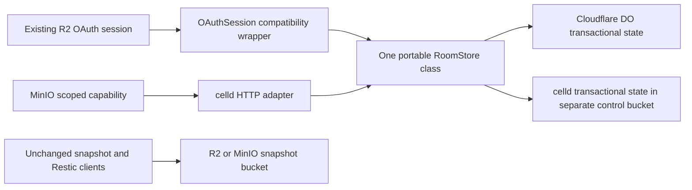

# One portable Room Store authority

Decision dated 2026-11-10. Experimental implementation, adoption gated.
Base `f1e77164a41b545060b574dfb07e41043e79fbe2`.

The owner's implementation brief selects one shared Durable Object authority.
The earlier issue's Option A stop condition does not govern this implementation.

## Shape and alternatives

Two viable portable shapes were compared locally. A pure reducer plus separate
storage orchestrators makes transitions easy to test, but leaves atomicity,
readback, and retry behavior in two implementations. A portable actor with the
standard DO storage transaction API keeps all those decisions together.
We select the latter. PStack's configured Claude/Grok design providers were
disabled in this session; no independent multi-model verdict is claimed.

`worker/src/room-store.js` exports `RoomStore`. Its record retains the existing
R2 schema, including the historical format name and storage key
`r2-room-store-material-v1`. That name is a compatibility wire contract, not
an R2 dependency. The record contains ciphertext, physical-domain hash,
generation, nullable repository ID, and schema identifiers.

The stable Cloudflare `OAuthSession` class delegates bucket requests to
`RoomStore`. Existing OAuth sessions, capability expiry, object names,
`OAUTH_SESSION` binding, migration tag, and stored ciphertext remain in place.
No Cloudflare migration or object rename is introduced.

The celld entry point exports that exact class. Its only responsibilities are
experimental enablement, domain routing, and signed read/write capabilities.
The fleet harness stages byte-identical source files before bundling. Both real
runtime harnesses execute the same contract module.

A single-instance workerd host is useful for compatibility tests, but lacks
celld's bucket-backed ownership and recovery fleet. It is not the selected
self-hosted operational runtime.

## State transitions

Missing -> initialized by one transaction. Identical initialization is
idempotent; a competing ciphertext conflicts. Binding requires the current
generation, advances it once, and cannot change the repository. Same-repository
retries accept that generation or its immediate predecessor. Other generations
conflict. Writes verify the transaction's readback. Corrupt records fail closed.
Read-only calls never initialize a record. Clients resolve ambiguous responses
by fresh material readback, including generation and binding checks. Explicit
authorization and generation rejections are never overridden by readback.

Rollback permanently seals the actor's writes in a transaction. Reads remain
available. Sealing before restoring a legacy record prevents simultaneous
legacy and portable writers. A sealed actor cannot be reused for migration.
A later adoption needs a separately reviewed namespace/version transition.

## Custody and compatibility

MinIO format 2 exposes the Restic password to bucket readers. Migration does
not change that password, operational age identity, recipients, UUID, Restic
repository, or ciphertext snapshots. It encrypts only the password and safe
material metadata to the existing operational and recovery recipients. Private
age identities are never uploaded to the actor. The existing bucket enrollment
record still contains its operational identity under the existing bucket-reader
trust contract. This is not a redesign of encryption enrollment.

After verifying the DO winner, migration conditionally replaces the exact
versioned keyset with a selection marker containing format-1 enrollment data,
authority URL, and domain hash. Old clients reject this marker. New clients
require an exact local authority URL match and resolve material from the DO.
The marker contains no Restic password. No outage fallback writes to S3.
A concurrent legacy write makes marker publication fail closed. Clients must
be stopped during migration and rollback. Historical S3 versions and readers
may retain the old password; changing custody does not revoke prior knowledge.

## Rollout and deletion gate

1. Qualify the experimental route on disposable Dimensions. Normal MinIO backup
   users retain the existing no-service dependency until explicit migration.
2. Owner-approved enrollment, capability issuance, migration and rollback proof
   precede any real Dimension switch. Production and real data were not touched.
3. Delete legacy MinIO upgrade/bind logic after supported Dimensions have
   migrated, packaged Linux/Windows consumers are qualified, and the rollback
   support window is explicitly closed. Remove the format-2 writer and
   `EncryptionKeyset.upgrade_for_room_store`/`bind_repository` callers together.
   Keep read/import tooling only for recovery. This is a removal gate, not a
   permanent alternative engine or a claim that deletion is already safe.

## Runtime and operational cost

celld v0.6.3, Apache-2.0, source
`8702f6d186c77698dbfb30cf29e3b1922a88f008`.
Linux x86-64 release gzip SHA-256
`5084a083472cf036551a7eac63fa24d22bb9a56323c517f63205724c12783047`.
MinIO source release `RELEASE.2025-04-22T22-12-26Z`, commit
`0d7408fc9969caf07de6a8c3a84f9fbb10a6739e`.
Upstream says community MinIO passes its storage contract but is not production
qualified. The owner's beta-risk acceptance permits this gated implementation,
not a production-readiness claim.

The self-hosted operator gains one service type, preferably two nodes, a separate
control bucket, private peer/operator networking, TLS ingress, fleet credentials,
and capability signing-key rotation. CLI/VSIX consumers gain no process or
package dependency; a migrated Dimension gains an authority availability
requirement. Snapshot and control buckets must have distinct access policies.
This initial rollout adds migration and verification code. It does not claim
an immediate net LOC reduction while compatibility remains supported.

## Verification and remaining gates

See `docs/portable-room-store.md` for exact commands and operation boundaries.
The disposable fleet runs two real celld nodes, competing writes, generation
rejection, expired/read-only/wrong-domain capabilities, lost-response readback,
SIGKILL, removal of both local caches, and recovery from MinIO alone.
Durability is explicitly `bucket`, so cold restoration does not accidentally
rely on an unuploaded follower log. The run does not establish default fleet-mode
partition tolerance or deployment readiness.

Workerd corruption injection uses a test-only subclass. Migration's real fleet
lane uses actual age encryption and Restic with injected loopback HTTP transport
and disabled local keyring caching. Production HTTPS ingress, real OS keyring,
live Cloudflare, installed VSIX, native Windows, and real-data adoption are
separate gates. Passing a source test or package build does not establish them.

## Quantitative maintenance comparison

Counts use source lines, excluding blank-line normalization and shipped mirrors.
The baseline Worker is 470 lines; its compatibility wrapper is now 385 lines.
The shared actor is 125 lines. There are two deployment adapters and one actor
implementation, with no copied celld transition logic. The two runtimes use
one shared contract module. The Python MinIO custody/selection/migration adapter
is 201 lines; it reuses the existing encrypted HTTP client instead of forking it.

Legacy MinIO upgrade/bind functions occupied 62 + 73 = 135 lines on main.
They remain during the migration window and now include marker routing.
Their deletion is therefore **0 lines so far**, not a claimed savings.
The old winner-validation helpers add 17 lines that can also disappear when
legacy writers are removed. Separate legacy `EncryptionKeyset` upgrade/bind
transitions are also removal candidates after their callers migrate.
The initial experimental change grows total source due to rollout tooling and
runtime verification. Its measurable simplification is one transition owner for
R2 and opted-in MinIO, not an immediate whole-repository LOC reduction.
Operational dependency changes from zero extra MinIO services to one celld
service type, with two nodes in the qualified disposable topology. Existing
unmigrated consumers retain zero extra services.
